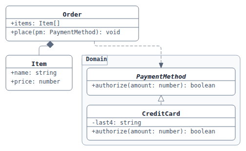
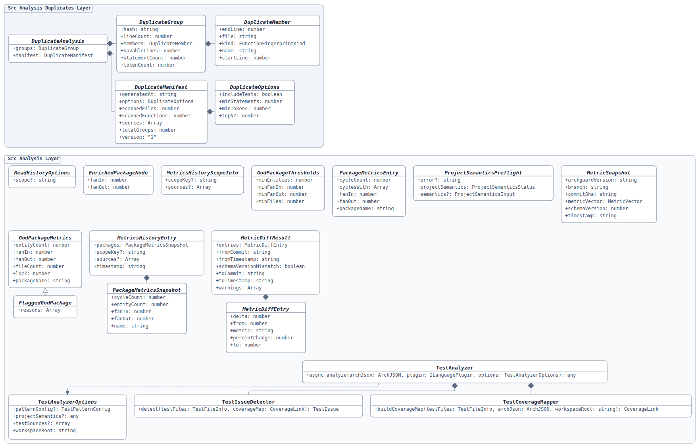
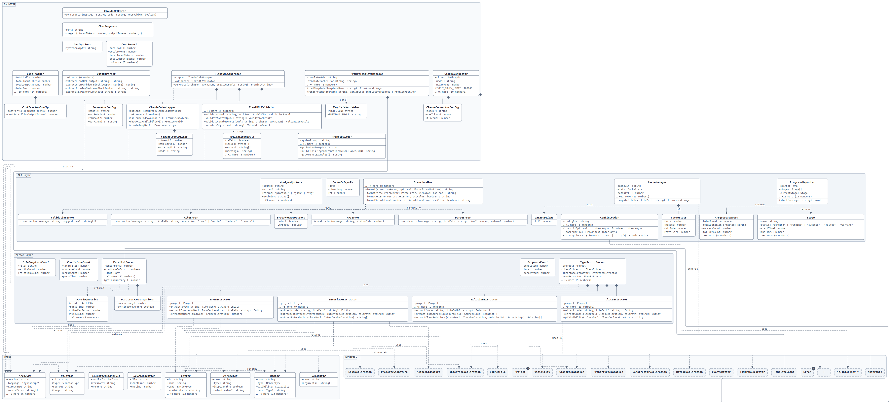
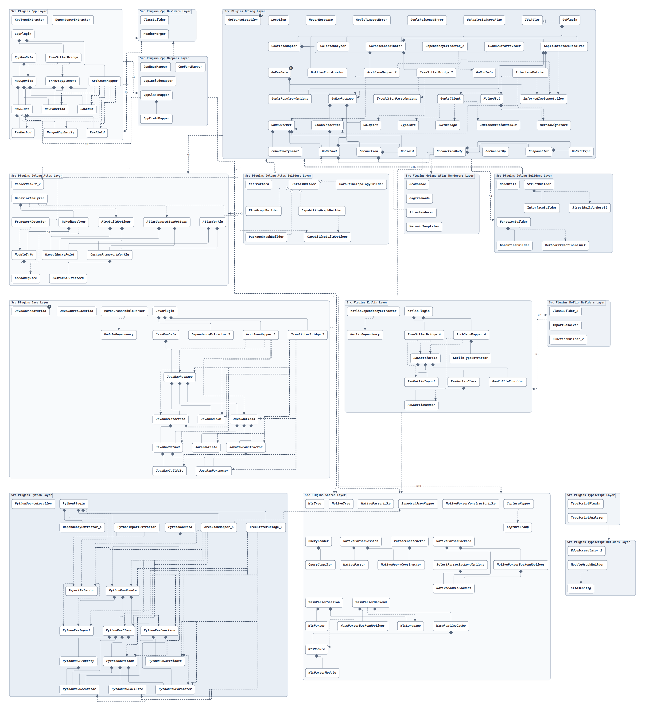
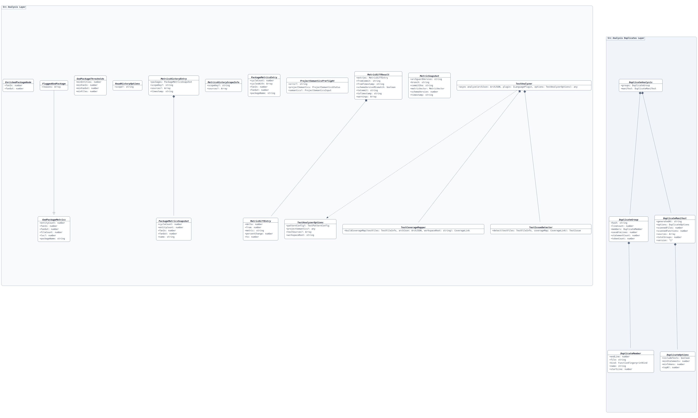

# Gallery

> Generated by `scripts/render-docs.mjs` from `scripts/docs-gallery.json` — do
> not edit this file by hand. Edit the manifest (or a source `.puml`), then run
> `npm run docs`. `npm run docs:check` fails in CI when this page has drifted.

## Quickstart

### Minimal class diagram

Three-compartment class/interface boxes, one package, and implementation (`..|>`), composition (`*--`) and dependency (`..>`) edges.

**Engine** elk · **Nodes** 4 · **Edges** 3 · [source](gallery-sources/quickstart.puml) · [svg](img/quickstart.elk.svg)

## Real graphs (elk)

### Small class diagram

A small real ArchGuard class diagram (≤25 entities) with package grouping and orthogonal edges.

**Engine** elk · **Nodes** 22 · **Edges** 10 · [source](gallery-sources/archguard-class.puml) · [svg](img/s-class.elk.svg)

### Medium architecture view

A medium architecture diagram (25–70 entities): packages, package-level corridors and bundled arrowheads.

**Engine** elk · **Nodes** 70 · **Edges** 59 · [source](gallery-sources/archguard-architecture.puml) · [svg](img/m-architecture.elk.svg)

### Large package slice

A 100–200 entity slice of a 660-entity graph, through the same full-graph pipeline (hub summarisation included).

**Engine** elk · **Nodes** 172 · **Edges** 215 · [source](gallery-sources/all-classes.puml) · [svg](img/l-plugins.elk.svg)

## elk vs viz

### Same small diagram, viz engine

The same source as `s-class`, rendered by the experimental `'viz'` engine. Compare with `s-class` above; see [docs/viz-decision.md](viz-decision.md) for the measured trade-off.

**Engine** viz · **Nodes** 22 · **Edges** 10 · [source](gallery-sources/archguard-class.puml) · [svg](img/s-class-viz.viz.svg)
